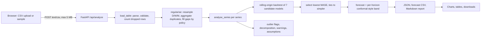

# Architecture

Author: Rayyan Anwar

## Flow and design choices
1. **Validation:** invalid dates and non-numeric values are dropped and counted; missing columns are rejected with a clear message. Up to 300,000 rows and 20 series.
2. **Regularisation:** frequency is inferred from the median gap (or set explicitly); several rows in a period are summed or averaged; empty periods are filled with zero, interpolation or last value (your choice, reported with counts).
3. **Model selection:** candidates are naive, seasonal naive, drift, SES, Holt, Holt-Winters and ridge lag regression. Each is backtested on up to 6 rolling origins (expanding window, no future data). The lowest MASE wins; ties go to the simpler model.
4. **Uncertainty:** the band is the chosen model's past absolute errors per horizon (finite-sample-corrected quantile). It is approximate with few origins, and the UI says so.
5. **Transparency:** every response carries warnings (short history, no gain over benchmark, intermittent demand, negative forecasts), assumptions, outliers (flagged, never removed) and a backtest table of all models.
6. **Exports:** forecast CSV (formula-injection safe), Markdown report, JSON.
